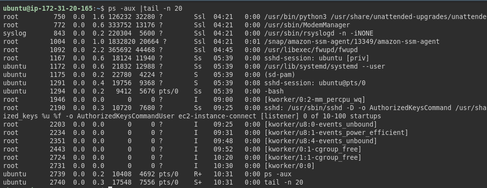
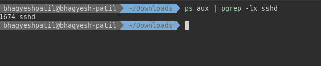
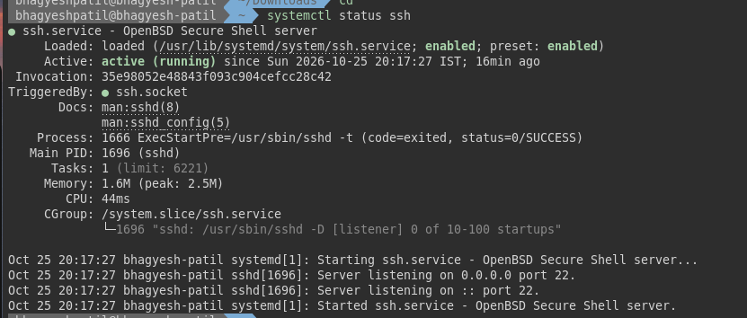
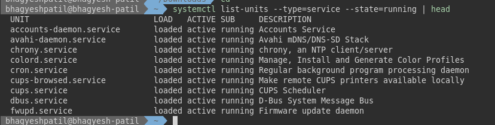
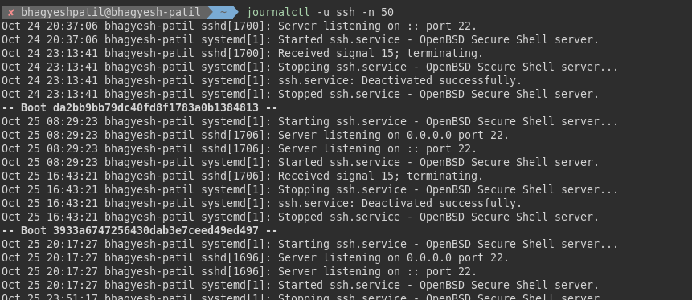
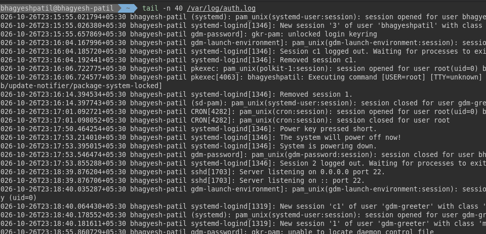

# Real time output of commands I practiced

## Process commands
* `ps -aux | head -n 10` - List running processes(top 10 lines).

* `pgrep -x sshd` - Get the process id by process name.

## Service commands
* `systemctl status | head -n 20` - Prints first 20 lines of system service status summary.

 `systemctl list-units --type=service --state=running | head` - Prints first 10 lines of running services status.

## Log commands
* `journalctl -u ssh` - Displays logs for the SSH service.

* `tail -n 40 /var/log/auth.log` - Last 40 lines of the authentication log(ssh, sudo).

