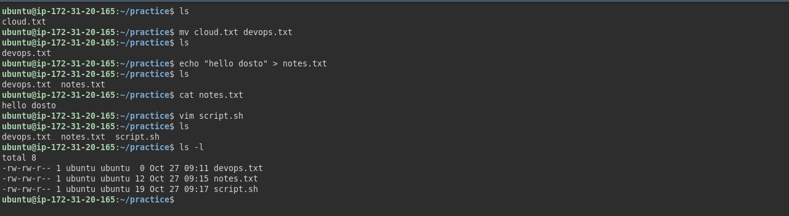
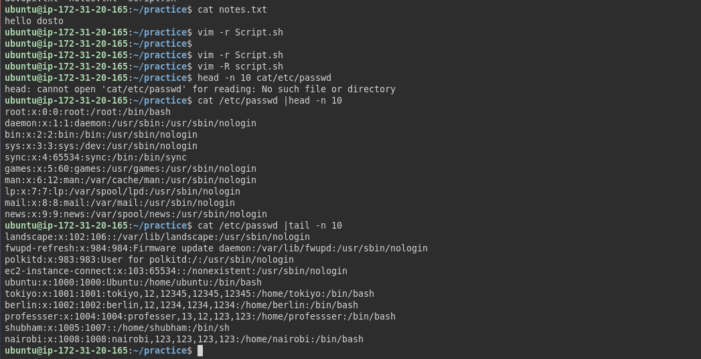
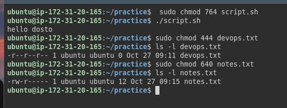
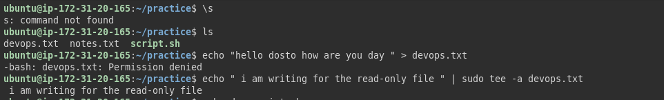
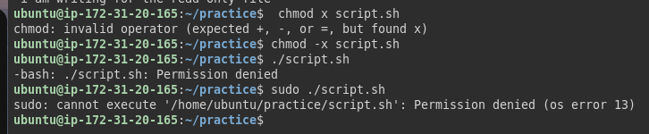

# File Permissions & File Operations Challenge

## Files Created

* Create empty file devops.txt using touch
* Create notes.txt with some content using cat or echo
* Create script.sh using vim with content: echo "Hello DevOps"
* Verify: ls -l to see permissions

   

   ## Read Files 

1. Read `notes.txt` using `cat`
2. View `script.sh` in vim read-only mode
3. Display first 5 lines of `/etc/passwd` using `head`
4. Display last 5 lines of `/etc/passwd` using `tail`

  

## Understand Permissions 

Format: `rwxrwxrwx` (owner-group-others)
- `r` = read (4), `w` = write (2), `x` = execute (1)

Check your files: `ls -l devops.txt notes.txt script.sh`

  

## Modify Permissions 

1. Make `script.sh` executable → run it with `./script.sh`
2. Set `devops.txt` to read-only (remove write for all)
3. Set `notes.txt` to `640` (owner: rw, group: r, others: none)
4. Create directory `project/` with permissions `755`

   

## Test Permissions 

  

  answer.try run read-only file normally gives permission denied with sudo ,you can override and write to the file but it the redirection it self is executed root privilidged

  

   answer : executing a file without execute permission give permission denied even sudo cannot by pass this because the shell require the execute bit . however you can still run the file by explicity invoking the interpreter

   ## Commands Used

* `touch fname` - Creates empty file.
* `echo "Hello" > fname` - Create file with content.
* `vim fname` - Create/open file in Vim.
* `cat fname` - Prints files content.
* `vim -R fname` - Open file in read only mode.
* `cat /etc/passwd | head -5` - Prints first 5 lines of /etc/passwd.
* `cat /etc/passwd | tail -5` - Prints last 5 lines of /etc/passwd.
* `chmod +x fname` - Adding executable permission for all(owner,group,others).
* `chmod -w fname` - Removing write permission for all(owner,group,others).
* `mkdir -m 755 dname` - Create directory with permissions(rwx,r-x,r-x).

## What I Learned

* Managing files permissions effectively.
* Using sudo can override read & write restrictions.
* Sudo cannot override execute permission but calling the interpreter directly allows execution.

