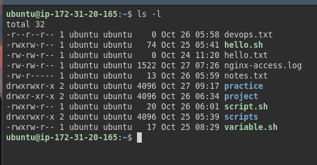
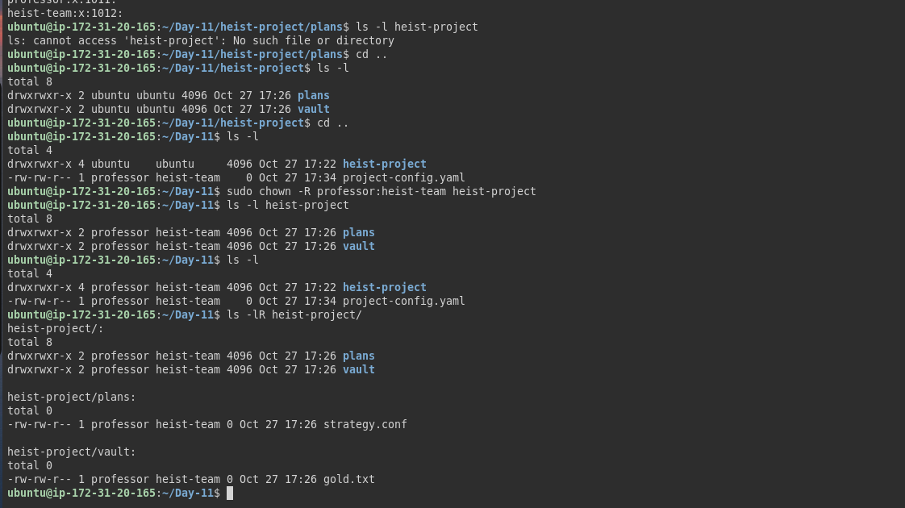
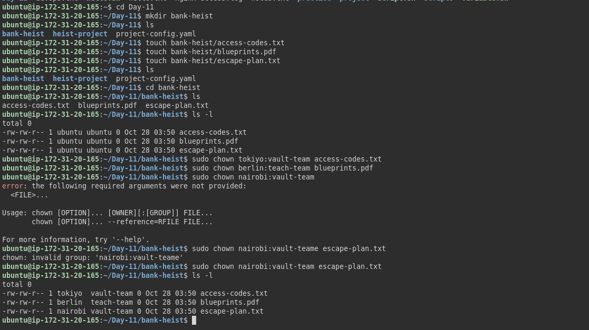

## Challenge Tasks

### Task 1: Understanding Ownership 

1. Run `ls -l` in your home directory
2. Identify the **owner** and **group** columns
3. Check who owns your files

  

Document: What's the difference between owner and group?
Answer 

 - owner  :- woh indivisual user jo file ka owner hai owner ke pass file ki permission ke according access hota hai 

 - group :-users ka ek collection jise file par shared permission di ja sakti hain 

## Task 3: Basic chgrp Operations 

1. Create file `devops-file.txt`

   command :- `touch devops-file.txt`

2. Check current owner: ## Task 3: Basic chgrp Operations 
     
     command :-  `ls -l devops-file.txt`
3. Change owner to `tokyo` (create user if needed)

    command :- `sudo chown tokyo devops-file.txt`

4. Change owner to `berlin`
     
     command :- `sudo chown berlin devops-file.txt`

5. Verify the changes
    
     command :- `ls -l devops-file.txt`

     ### Task 3: Basic chgrp Operations 

1. Create file `team-notes.txt`
    
      command :- touch team-notes.txt
2. Check current group: 
       
       command :- `ls -l team-notes.txt`

3. Create group: 

       command:- `sudo groupadd heist-team`

        
4. Change file group to `heist-team`
        
  command :- `sudo chgrp heist-team team-notes.txt`

5. Verify the change
    
    command :- `ls -l team-notes.txt`

    ### Task 4: Combined Owner & Group Change (15 minutes)

Using `chown` you can change both owner and group together:

1. Create file `project-confi### Task 6: Practice Challenge

1. Create users: `tokyo`, `berlin`, `nairobi` (if not already created)
2. Create groups: `vault-team`, `tech-team`
3. Create directory: `bank-heist/`
4. Create 3 files inside:
   ```
   touch bank-heist/access-codes.txt
   touch bank-heist/blueprints.pdf
   touch bank-heist/escape-plan.txt
   ```

5. Set different ownership:
   - `access-codes.txt` → owner: `tokyo`, group: `vault-team`
   - `blueprints.pdf` → owner: `berlin`, group: `tech-team`
   - `escape-plan.txt` → owner: `nairobi`, group: `vault-team`

**Verify:** `ls -l bank-heist/`g.yaml`
    
    command :- `touch project-config.yaml`

2. Change owner to `professor` AND group to `heist-team` (one command)

    command :- `sudo chown professor:heist-team project-config.yaml`

3. Create directory `app-logs/`
     
     command mkdir app-logs/
## Task 3: Basic chgrp Operations 
4. Change its owner to `berlin` and group to `heist-team`

     command :- sudo chown berlin:heist-team app-logs

### Task 5: Recursive Ownership 

1. Create directory structure:
   ```
   mkdir -p heist-project/vault
   mkdir -p heist-project/plans
   touch heist-project/vault/gold.txt
   touch heist-project/plans/strategy.conf
   ```

2. Create group `planners`: `sudo groupadd planners`

3. Change ownership of entire `heist-project/` directory:
   - Owner: `professor`
   - Group: `planners`
   - Use recursive flag (`-R`)

4. Verify all files and subdirectories changed: `ls -lR heist-project/`




### Task 6: Practice Challenge

1. Create users: `tokyo`, `berlin`, `nairobi` (if not already created)
2. Create groups: `vault-team`, `tech-team`
3. Create directory: `bank-heist/`
4. Create 3 files inside:
   ```
   touch bank-heist/access-codes.txt
   touch bank-heist/blueprints.pdf
   touch bank-heist/escape-plan.txt
   ```

5. Set different ownership:### Task 6: Practice Challenge

1. Create users: `tokyo`, `berlin`, `nairobi` (if not already created)
2. Create groups: `vault-team`, `tech-team`
3. Create directory: `bank-heist/`
4. Create 3 files inside:
   ```
   touch bank-heist/access-codes.txt
   touch bank-heist/blueprints.pdf
   touch bank-heist/escape-plan.txt
   ```

5. Set different ownership:
   - `access-codes.txt` → owner: `tokyo`, group: `vault-team`
   - `blueprints.pdf` → owner: `berlin`, group: `tech-team`
   - `escape-plan.txt` → owner: `nairobi`, group: `vault-team`

**Verify:** `ls -l bank-heist/`
   - `access-codes.txt` → owner: `tokyo`, group: `vault-team`
   - `blueprints.pdf` → owner: `berlin`, group: `tech-team`
   - `escape-plan.txt` → owner: `nairobi`, group: `vault-team`

**Verify:** `ls -l bank-heist/`

  

  # i learned from whole Assignment 

Key Learning

I learned that Linux uses file permissions and ownership to control who can read, write, and execute files. I also learned the difference between normal user permissions and sudo privileges.

This is important in DevOps because configuration files, scripts, logs, and application files often have different ownership and permission requirements.

## Commands Used

- View ownership : `ls -l filename`
- Change owner only : `sudo chown newowner filename`
- Change group only : `sudo chgrp newgroup filename`
- Change both owner and group : `sudo chown owner:group filename`
- Recursive change (directories) : `sudo chown -R owner:group directory/`
- Change only group with chown : `sudo chown :groupname filename` 


